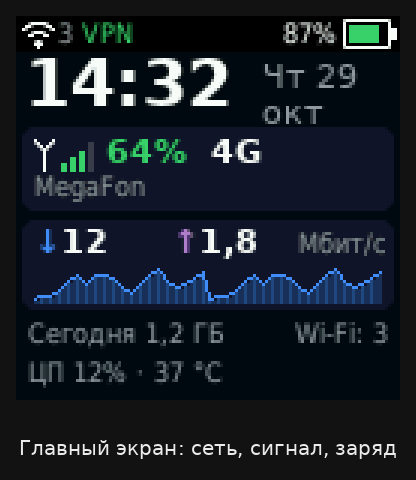
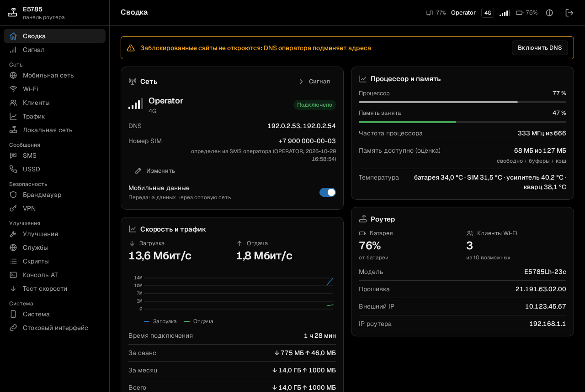

# E5785Lh-23c: VPN, split routing for Russian sites and a custom OLED menu

<p align="center"></p>

The clip is rendered on a PC by the real menu code with made-up data. Captions are in Russian.

Highlights: AmneziaWG 2.0/3.1 VPN on the router itself, Russian IP ranges bypass the tunnel, DNS over HTTPS/TLS with fallback servers and ad blocking, DPI bypass (`zapret2`, `tpws`), an OLED menu and a new single-page web panel.



For owners of the Huawei E5785Lh-23c. How to bring the router back after a wrong firmware, and what to install on top of the bay v5 mod. Includes tools, guides, an OLED menu with a custom home screen, boot logo, boot animation, a game and a web panel. Detailed guides are in Russian, in `docs/`.

> Warning: E5785Lh-23c only (board `CL1E5785SM VER.A`, dload id `E5785__0`). Do not use on the E5785Lh-22c: it has a different display, reset button and partition layout. Use at your own risk. Back up your NV before writing anything.

## What is here

| path | what it is |
|---|---|
| `docs/features.md`, `docs/pdf/e5785lh-23c-features.pdf` | all features with snapshots, status and details (in Russian) |
| `docs/install.md`, `docs/pdf/e5785lh-23c-install.pdf` | install: choose your path, one command, check, rollback, all steps (in Russian) |
| `docs/recovery.md` | recovery from download mode: fastboot in RAM, the `OKAY` at offset `0x2000` trap, byte-exact verification |
| `docs/nv-fix.md` | NV repair after a foreign firmware: section `product_id=33` of the official `Nvdload`, `nvsys` refresh through `/dev/nv` index 93 |
| `docs/thermal.md` | false thermal shutdowns: cause and check |
| `docs/oled-menu.md` | OLED menu: features, install, rollback, build |
| `docs/boot-logo.md` | boot logo and animation |
| `docs/vpn.md` | VPN item in the menu and the status icon |
| `docs/troubleshooting.md` | common problems |
| `tools/` | our scripts: loader patch, YAFFS2 images, NV fix generator, logo image, USB bridges; `tools/recovery/bin/` has a ready `balong-usbdload` (GPL-3.0), `build.sh` builds `balong_flash` |
| `oled-menu/` | menu sources, patch against upstream `0807e72`, reproducible build, ready set with `install.sh` and `rollback.sh` |
| `boot/`, `game/`, `webui/` | logo and animation, the Orbit game, the web panel |
| `kernel-module/` | experimental AmneziaWG kernel module for Linux 3.10: `neon` by default, `scalar` as a spare; do not unload it (kernel panic) |

## One-command install

For a router that already runs the bay v5 mod, from the root of the set on your computer:

```bash
webui/src/pkg/get-bins.sh        # package binaries from prebuilt/, no network; add --module for the kernel module
./install-all.sh --dry-run       # checks and plan, flash is not changed
./install-all.sh                 # panel and menu
```

The script checks the model and the mod, stops at the first error and prints rollback commands. Guide in Russian: `docs/install.md`. A real install with this script was never run on the router. Manual order below.

## Install order

1. Router does not boot, or runs stock firmware: `docs/recovery.md` (21.191.63.02, bay v5 mod, `modwebui_1.5a`). The path from stock firmware is the same but untested: it was done on a router broken by 22c firmware. Back up the start of the flash first and skip the NV fix unless 22c firmware was flashed.
2. A 22c firmware was installed: `docs/nv-fix.md`. Skipping it leaves no mobile network and causes false thermal shutdowns.
3. Set up SSH through the mod's menu.
4. Install the web panel: `webui/README.md`, then check that it came up, see below. Without the panel the VPN, DNS and speed test menu items stay hidden.
5. Install the OLED menu: `docs/oled-menu.md`.

No Huawei or mod binaries are included: firmware, `oled.orig`, `cms`, `fastboot`, `usblsafe`, `modem_fw`, `WebApp`. Get them from your firmware or from [e5785lh-23c-mod-bin](https://github.com/vakame7058/e5785lh-23c-mod-bin). Our scripts patch your own copies and check their checksums.

## Check first

Installing the set on a clean router was not tested. After installing the panel and after the first reboot, check that the panel and the VPN came up:

```bash
curl -s -o /dev/null -w '%{http_code}\n' http://192.168.1.1/
ssh root@192.168.1.1 'busyboxx sh /online/mod/mod-ctl.sh status; busyboxx sh /online/mod/pkg/awg/svc.sh brief'
```

Expected: `200` from `curl`; the helper line of `mod-ctl.sh status` says «работает» and «очередь отвечает»; if the VPN is enabled, `svc.sh brief` shows `running=1` and `engine=kernel` or `engine=go`.

Risk: `/online` belongs to uid 1000, so a process with that uid can replace `/online/mod` and gain root.

## Status

Everything ran on a single router.

| what | state |
|---|---|
| OLED menu, all items including VPN, custom scripts, «РФ напрямую» (direct RU), DNS and Orbit | checked by the user on one router |
| home screen, boot logo, animation | checked by the user on one router |
| web panel pages, saving settings | checked by the user on one router |
| long-term running | not tested |
| split VPN | on by default; without a loaded list it is a plain full VPN. You build the list yourself with `split-gen.py` (RIPE terms apply, this is not legal advice). Checked by the user on one router and on a container client, bank apps on a phone not tested |
| profile switch on outage | on by default; tested on the router with shortened thresholds, the real 180, 300 and 1800 s are only enabled |
| DNS with VPN | comes up with the VPN unless turned off by hand; fallback servers when DoT fails |
| boot | `/dev/random` is replaced with `/dev/urandom` when a seed file exists: real addresses after about 30 s, tested by reboot. First boot without a seed file takes about 3 minutes |
| speed | direct up to 105 Mbit/s; through VPN 21–46 Mbit/s depending on server and streams (CPU limit); one stream 7–22 |
| charge limit | not implemented; a built-in protection exists by kernel function names, not measured |
| kernel module | experimental, `neon` by default: 164 MB run, 0 kernel errors. Never unload it: packets queued in the modem make that a kernel panic. Stop with `ip link del`, roll back by rebooting |
| VPN autostart | tested by reboot: tunnel up by itself by 26 s, protocol 2.0 profile, kernel module; panel answers http 200, helper works. The «Включать при загрузке роутера» setting is off by default |
| fallback to `amneziawg-go` | switch and server handshake work, internet through the tunnel on this path not confirmed |
| install on a clean router | not tested, see above |
| `install.sh --via=jump`, `get-bins.sh --fetch` download, Lua syntax with `luac` | not tested |
| real install from `prebuilt/` on the router, sha256 check against programs on the router | not tested |
| `install-all.sh` | tested on stubs and with a real `--dry-run` on the router; a real install with it, the `--reboot` branch and writing the logo with it were never run |
| `flash_fw.sh`, NV values from XML, loading with the ready `balong-usbdload` | never run on the router, see «Ограничения» in the guides |

## Credits

alexbers (huawei_oled_hijack_ng), ValdikSS, bay3255, forth32, saqie1393, e-dok, depau and the 4PDA thread 907081. See [CREDITS.md](CREDITS.md).

## License

Our scripts, tools, web panel and docs: MIT. OLED menu and game: LGPL-3.0, like the upstream project. Kernel module: GPL-2.0. See [CREDITS.md](CREDITS.md) and [LICENSES/](LICENSES/).
