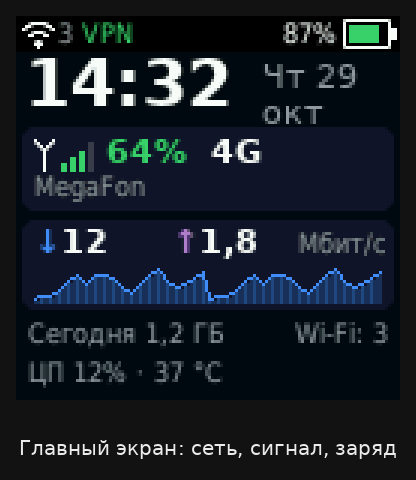
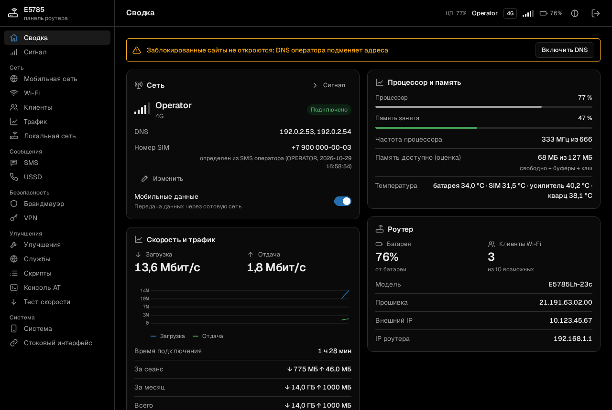
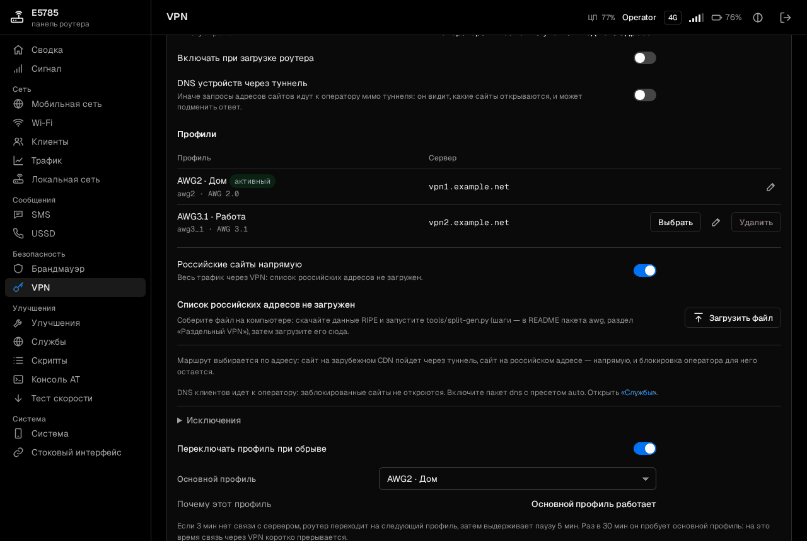

# E5785Lh-23c: VPN, обход блокировок и свое меню на экране

Доработки для мобильного роутера Huawei E5785Lh-23c поверх мода bay v5: VPN AmneziaWG прямо в роутере, российские сайты мимо VPN, шифрованный DNS, меню на экране и новая веб-панель. Здесь же инструменты, чтобы вернуть роутер после чужой прошивки.

> Внимание: только для E5785Lh-23c (плата `CL1E5785SM VER.A`, dload id `E5785__0`). На E5785Lh-22c ставить нельзя: другой экран, другая кнопка сброса, другая раскладка разделов. Все, что здесь есть, вы делаете на свой риск. Перед записью снимайте копии NV.

<p align="center"></p>

Ролик снят со стенда: кадры рисует настоящий код меню на компьютере, данные выдуманные.

## Что умеет

| что | как это выглядит |
|---|---|
| VPN в роутере | AmneziaWG 2.0 и 3.1, а также WireGuard и OpenVPN мода. Туннель для всех устройств в Wi-Fi, ничего ставить на телефон не нужно |
| РФ напрямую | российские адреса идут мимо VPN, остальное в туннель. Включается кнопкой на экране или в панели |
| Смена профиля при обрыве | если сервер не отвечает, роутер переходит на другой профиль и потом возвращается |
| Шифрованный DNS | DoH и DoT: Cloudflare, Quad9, Google, Яндекс, AdGuard; запасные серверы при отказе |
| Блокировка рекламы | через DNS, список hagezi, свои исключения |
| Обход DPI | `zapret2` и `tpws` |
| Меню на экране | VPN, DNS, режим сети, сигнал, SMS, Wi-Fi, тест скорости, работа без батареи, игра «Орбита» |
| Веб-панель | все настройки роутера и мода на одной странице, тест скорости, темная тема, раскладка для телефона |

Скорость: напрямую до 105 Мбит/с, через VPN 21–46 Мбит/с, упор в процессор роутера. Все проверено на одном роутере; статус каждой функции — в [docs/features.md](docs/features.md).

## Веб-панель

Открывается по `http://192.168.1.1/`, стоковый интерфейс остается на месте.





Снимки сделаны на моке с тестовыми данными. Остальные страницы: [webui/README.md](webui/README.md).

## Файлы прошивок

Прошивки Huawei, мод bay v5, WebUI и загрузчик `usblsafe` лежат отдельно, в [e5785lh-23c-mod-bin](https://github.com/vakame7058/e5785lh-23c-mod-bin): это чужие файлы. Там же контрольные суммы и порядок установки.

## Что куда

| что | документ |
|---|---|
| все возможности, снимки, статус каждой, подробности | [docs/features.md](docs/features.md), [PDF](docs/pdf/e5785lh-23c-features.pdf) |
| установка: выбор пути, одна команда, проверка, откат, все шаги | [docs/install.md](docs/install.md), [PDF](docs/pdf/e5785lh-23c-install.pdf) |
| роутер не загружается, режим прошивки, стоковая прошивка | [docs/recovery.md](docs/recovery.md) |
| нет сети после прошивки от 22c | [docs/nv-fix.md](docs/nv-fix.md) |
| роутер сам выключается | [docs/thermal.md](docs/thermal.md) |
| установщик `install-all.sh` | [docs/install-all.md](docs/install-all.md) |
| меню экрана | [docs/oled-menu.md](docs/oled-menu.md) |
| логотип и анимация | [docs/boot-logo.md](docs/boot-logo.md) |
| VPN | [docs/vpn.md](docs/vpn.md), [webui/README.md](webui/README.md) |
| модуль ядра AmneziaWG | [kernel-module/README.md](kernel-module/README.md) |
| что-то пошло не так | [docs/troubleshooting.md](docs/troubleshooting.md) |
| авторы и лицензии | [CREDITS.md](CREDITS.md) |

## Порядок установки

Порядок, что нужно, проверка и список непроверенного: [docs/install.md](docs/install.md). Коротко, если мод bay v5 уже стоит:

```bash
webui/src/pkg/get-bins.sh
./install-all.sh --dry-run
./install-all.sh
```

Настоящая установка этим скриптом на роутере не запускалась.

## Что в комплекте

| каталог | что это |
|---|---|
| `docs/` | документы в Markdown; `docs/pdf/` — весь текст двумя PDF: возможности и установка |
| `tools/recovery/` | загрузчик с таблицей 23c, образы YAFFS2 и `m3boot`, запись, сверка байт в байт; `bin/` — готовый `balong-usbdload` |
| `tools/nv/` | правка NV из официального пакета, проверка `nvsys` |
| `tools/logo/` | образ раздела `logo` |
| `tools/bridge/` | мосты до веб-интерфейса роутера по USB |
| `oled-menu/` | меню экрана: исходники, патч к исходному проекту, сборка, готовый набор, проверки на компьютере |
| `boot/` | логотип и анимация: PNG, `frames.bin`, генераторы |
| `game/` | игра «Орбита» |
| `webui/` | веб-панель: исходники, пакеты, установщик |
| `kernel-module/` | экспериментальный модуль AmneziaWG для ядра 3.10: `neon` по умолчанию и `scalar`, выгружать нельзя |
| `LICENSES/` | тексты лицензий |
| `packaging/` | сборка обоих PDF `build_guide.sh`, картинки `mk_images.py`, ролик `mk_demo.py`, проверки установщика `test/` |

Файлов Huawei и мода здесь нет: прошивки, `oled.orig`, `cms`, `fastboot`, `usblsafe`, `modem_fw`, `WebApp` вы берете сами из прошивки или из [e5785lh-23c-mod-bin](https://github.com/vakame7058/e5785lh-23c-mod-bin). Скрипты правят ваши копии и сверяют контрольные суммы.

## Благодарности

alexbers, ValdikSS, bay3255, forth32, saqie1393, e-dok, depau, amnezia-vpn, bol-van и участникам темы 907081 на 4PDA. Полный список и лицензии — в [CREDITS.md](CREDITS.md).
