# Возможности E5785Lh-23c

Для того, кто решает, ставить ли комплект. Здесь все возможности, снимки и цифры с честным статусом. Как ставить: [установка](install.md).

Все снимки сделаны на стенде и моке с тестовыми данными, это не фото: кадры рисует настоящий код на компьютере. Весь комплект проверен на одном роутере E5785Lh-23c, на других не проверялся.

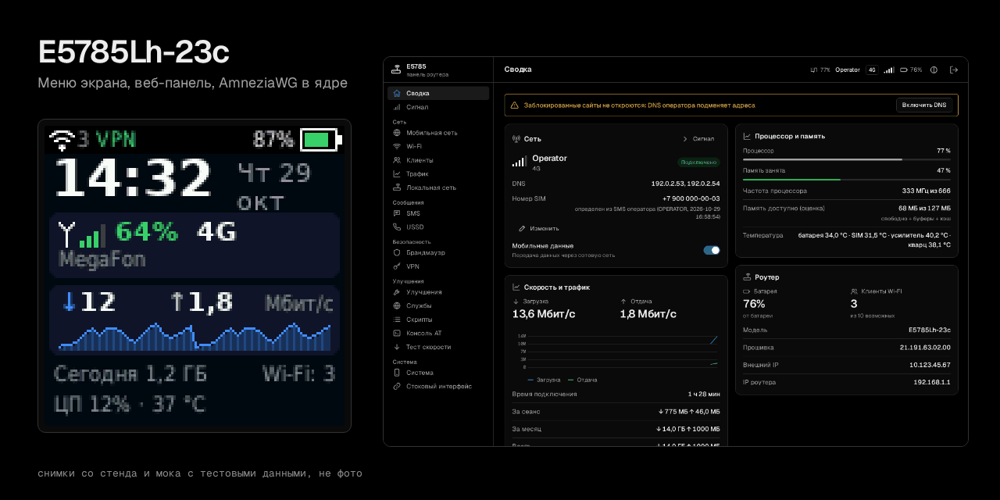

| статус | что значит |
|---|---|
| на роутере | проверено на настоящем роутере, есть замер или запись проверки |
| проверено пользователем на одном роутере | пользователь проверил у себя в обычной работе, отдельного замера нет |
| не проверено | не запускалось |

## Меню экрана и главный экран

Основа — [huawei_oled_hijack_ng](https://github.com/alexbers/huawei_oled_hijack_ng). Подробно: [меню экрана](oled-menu.md).

### Главный экран

Часы, дата, сигнал в процентах, тип сети, оператор, скорость с графиком, трафик за сегодня, клиенты Wi-Fi, ЦП, температура батареи. Статус: проверено пользователем на одном роутере.

Оператор берется по MCC-MNC из таблицы, иначе показывается имя, которое передает сеть.

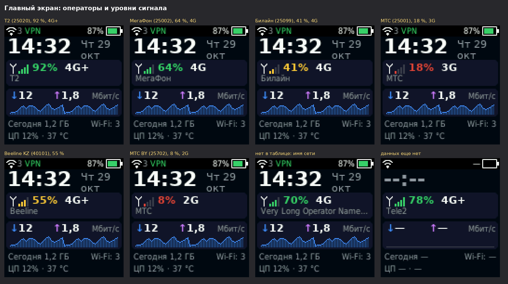

Заряд, перегрев, SIM, роуминг и SMS идут плашками на своем экране, остальные родные окна открываются поверх.

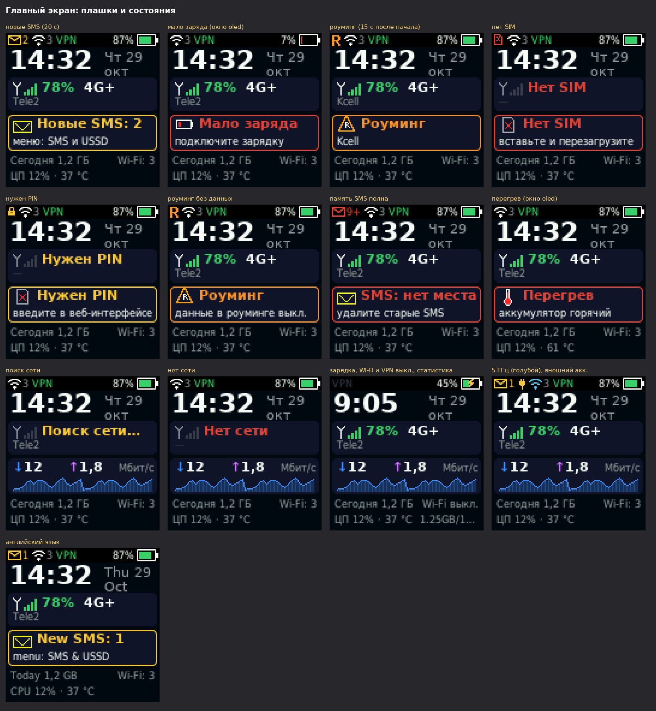

Значок VPN в строке значков показывает, есть ли связь с сервером: зеленый — рукопожатие не старше 180 с, серый — старше, значка нет — туннель выключен.

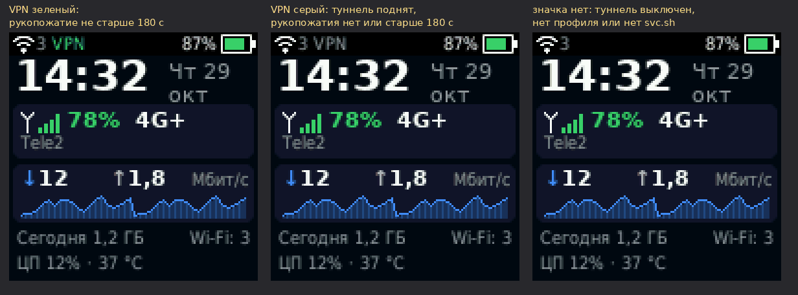

### Меню

Открывается долгим нажатием МЕНЮ, коротким POWER на главном экране и пунктом «Расширенные» родного меню. Кнопки подтверждены на роутере. Пункт виден, только если есть нужные ему файлы.

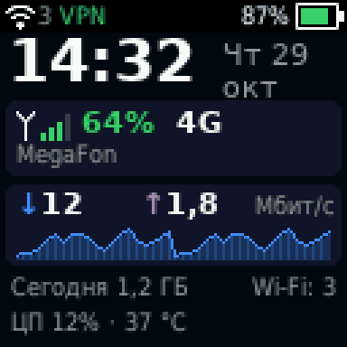

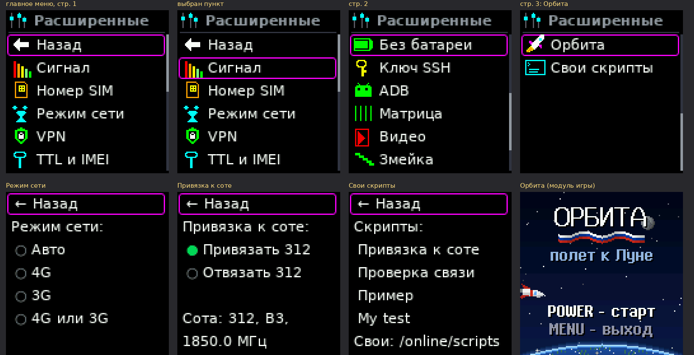

| пункт | что дает | статус |
|---|---|---|
| Сигнал | RSRP, RSRQ, SINR, RSSI, полоса, диапазон, график | проверено пользователем на одном роутере |
| Номер SIM | номер из настроек SIM или кэша панели | проверено пользователем на одном роутере |
| Режим сети | авто, 4G, 3G, 4G или 3G | проверено пользователем на одном роутере |
| SMS и USSD | чтение, удаление, запрос USSD; нужен компонент SMS | проверено пользователем на одном роутере |
| Wi-Fi | включить и выключить, клиенты, запрет по MAC | проверено пользователем на одном роутере |
| VPN | состояние, включить и выключить, профили | проверено пользователем на одном роутере |
| РФ напрямую на странице VPN | раздельный режим кнопками | проверено пользователем на одном роутере |
| DNS | включить и выключить, сервер, блокировка рекламы | проверено пользователем на одном роутере |
| Тест скорости | прием и передача с графиком | на роутере |
| TTL и IMEI | пункт мода без изменений, комплект его не касается | проверено пользователем на одном роутере |
| Без батареи | работа от USB без аккумулятора | проверено пользователем на одном роутере |
| Ключ SSH, ADB | вход по своему ключу, запуск `adbd` мода | проверено пользователем на одном роутере |
| Матрица, Змейка, Видео | заставка, игра, поток с сервера автора исходного меню | проверено пользователем на одном роутере |
| Свои скрипты | «Привязка к соте», «Проверка связи», скрипты из `/online/scripts` | проверено пользователем на одном роутере |

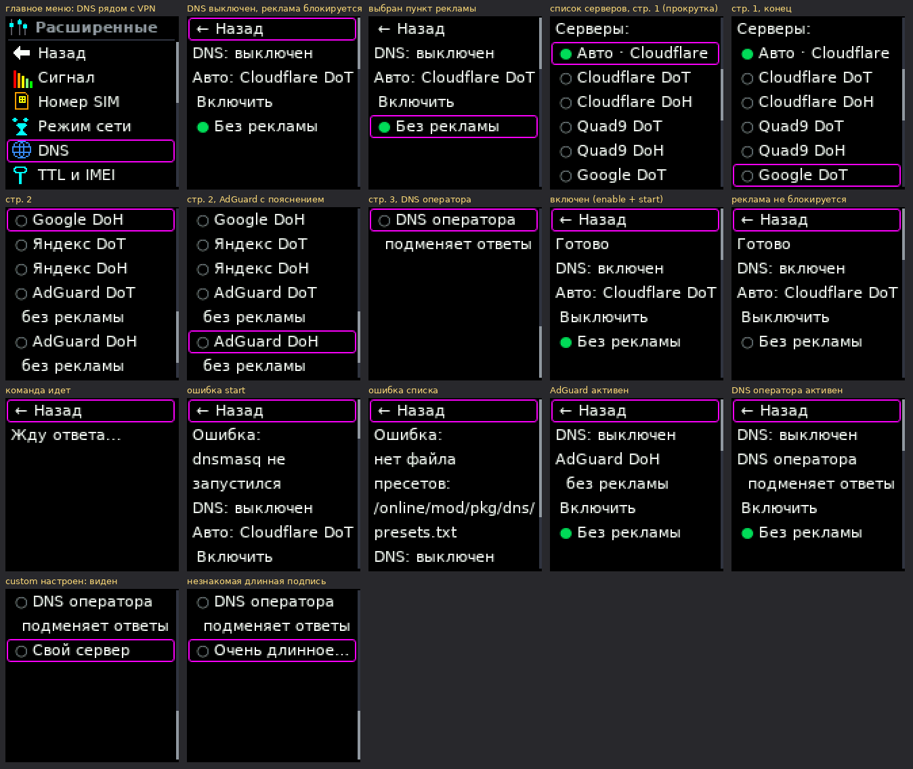

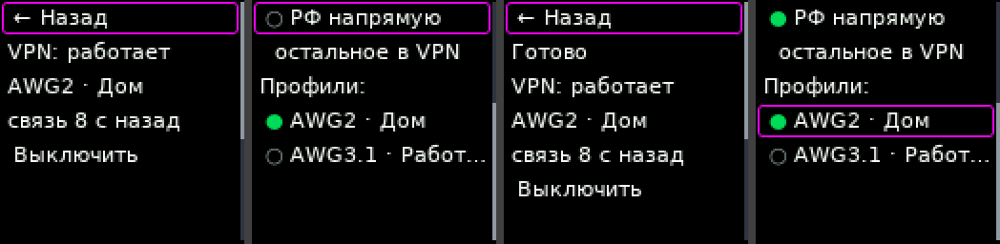

### Орбита

Игра на одну кнопку: ракета летит к Луне, POWER дает импульс тяги, МЕНЮ ставит паузу. Идет 20 кадров в секунду, рекорд хранится на роутере. Статус: проверено пользователем на одном роутере; на компьютере 200 000 кадров с проверками памяти и потоков. Подробно: [game/README.md](../game/README.md).

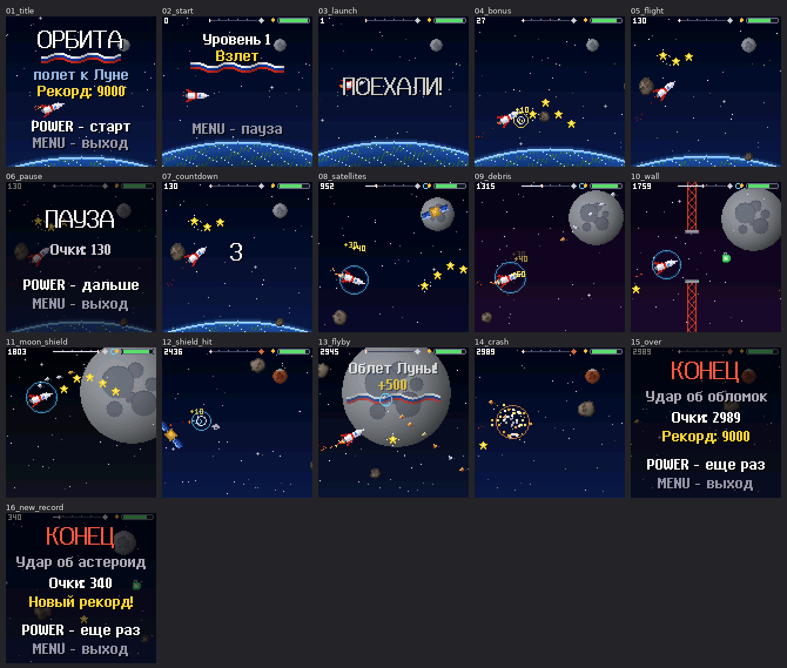

### Логотип и анимация

Логотип «Подготовка...» в разделе `logo`, цветная анимация «Поехали!»: 66 кадров, 4320 мс. Можно заменить своими. Статус: проверено пользователем на одном роутере. Подробно: [логотип и анимация](boot-logo.md).

## Веб-панель

Одна страница со всеми функциями стокового интерфейса и мода, светлая и темная тема, раскладка для телефона и компьютера. Открывается по `http://192.168.1.1/`, стоковый интерфейс остается на месте. Подробно: [webui/README.md](../webui/README.md).

Статус: страницы и сохранение настроек проверены пользователем на одном роутере. Снимки сделаны на моке.

| страница | что есть |
|---|---|
| Сводка | оператор, сигнал, скорость, трафик, батарея, клиенты, мобильные данные, процессор, память, температура |
| Сигнал | RSRP, RSRQ, SINR, RSSI, данные соты, наведение антенны: крупные цифры, график, звук; привязка к соте |
| Мобильная сеть | данные, роуминг, режим сети, диапазоны LTE, поиск оператора, APN |
| Wi-Fi | имя, пароль, защита, канал, страна |
| Клиенты | подключенные устройства, фильтр по MAC |
| Трафик | сеанс, месяц, лимит, сброс счетчиков |
| Локальная сеть | адрес роутера, имя, DHCP, постоянные адреса |
| SMS, USSD | чтение, отправка, удаление; запросы оператору; номер SIM |
| Брандмауэр | проброс портов, DMZ, UPnP, NAT, фильтр адресов |
| VPN | см. раздел [VPN](#vpn) |
| Улучшения | исправление TTL, ускорение SPE, режим сети через модем, режим без батареи |
| Службы | см. раздел [DNS и обход блокировок](#dns-и-обход-блокировок) |
| Скрипты | свои скрипты в `/online/scripts`: правка, запуск, автозапуск |
| Консоль AT | команды модему |
| Тест скорости | см. ниже |
| Система | сведения, перезагрузка, выключение, сброс, копия настроек, пароль, время, журналы, опасные настройки |
| Стоковый интерфейс | ссылки на страницы стока для редких функций |

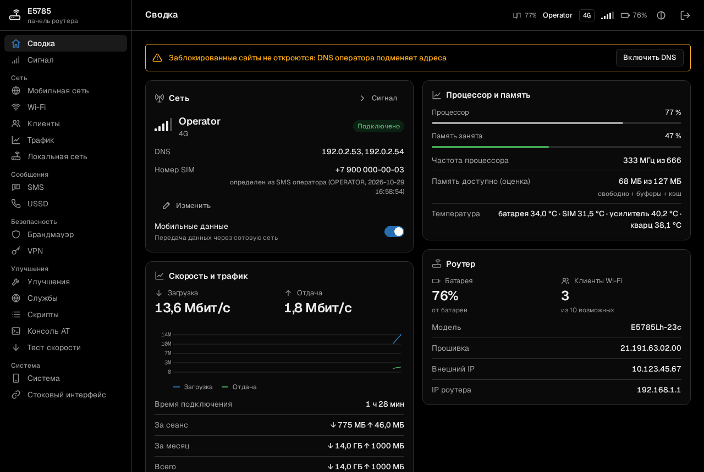

### Тест скорости

Замер приема и отдачи в один и несколько потоков, выбор сервера, замер через VPN, «Сравнить», история, график загрузки процессора. Статус: на роутере.

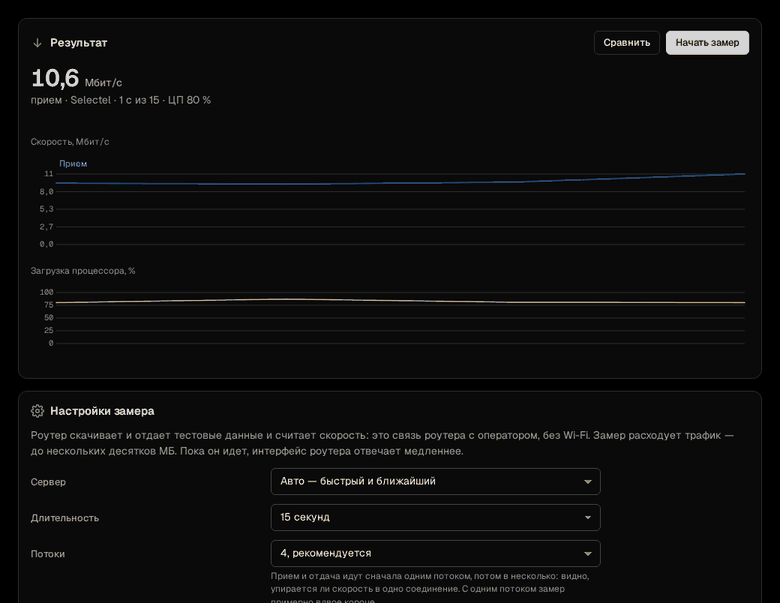

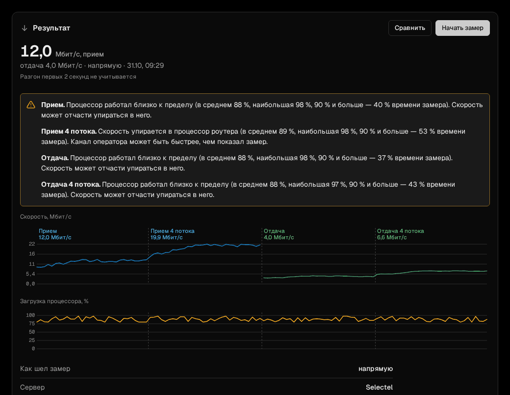

| где | скорость, Мбит/с |
|---|---|
| напрямую | до 105 |
| через VPN | 21–46, зависит от сервера и потоков, упор в процессор |
| через VPN, один поток | 7–22 |

Больше этого не обещаем.

## VPN

Подробно: [VPN](vpn.md), [README пакета](../webui/src/pkg/awg/README.md).

| возможность | что дает | статус |
|---|---|---|
| AmneziaWG до версии 3.1 | протоколы 2.0 и 3.1, профили с подписями | на роутере, настоящие профили |
| модуль ядра, вариант NEON | туннель в ядре, ЦП на мегабит чаще ниже. Экспериментальный, [выгружать нельзя](../kernel-module/README.md) | на роутере: прогон 164 МБ, ошибок ядра 0 |
| `amneziawg-go` | запасной путь, если модуль не сработал | переход и связь с сервером есть, выход в интернет через туннель не подтвержден |
| автозапуск | «Включать при загрузке роутера», по умолчанию выключено | на роутере: поднялся к 26 с, панель отвечает |
| раздельный режим | российские адреса напрямую, остальное в туннель; включен по умолчанию, без списка это обычный полный VPN | проверено пользователем на одном роутере, на клиенте-контейнере; приложения банков на телефоне не проверены |
| смена профиля при обрыве | переход на другой профиль и возврат; включена по умолчанию | на роутере с сокращенными порогами; настоящие 180, 300 и 1800 с только включены |
| WireGuard и OpenVPN мода | те же страницы панели | проверено пользователем на одном роутере |

Список адресов для раздельного режима вы собираете сами из данных RIPE NCC скриптом `split-gen.py`: комплект его не содержит. Условия RIPE прочитайте сами, это не юридическое заключение.

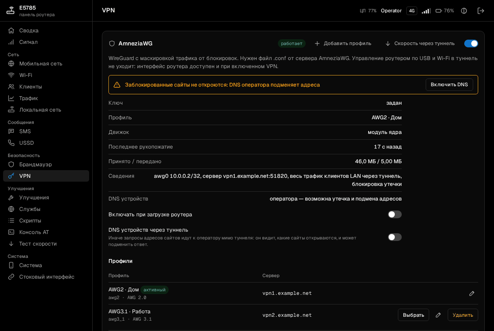

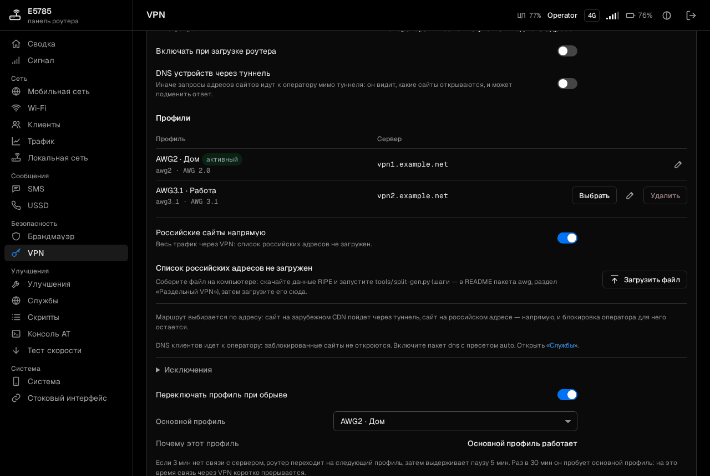

## DNS и обход блокировок

Подробно: [пакет dns](../webui/src/pkg/dns/README.md), [tpws](../webui/src/pkg/tpws/README.md), [zapret2](../webui/src/pkg/zapret2/README.md).

| возможность | что дает | статус |
|---|---|---|
| пресеты DNS | Cloudflare, Quad9, Google, Яндекс, AdGuard по DoT и DoH, DNS оператора, свой сервер | на роутере |
| DNS вместе с VPN | включается с VPN, если вы не выключили его сами | на роутере |
| запасные серверы | при отказе DoT служба переходит на Quad9 и Google, затем на DNS оператора, и возвращается | на роутере |
| блокировка рекламы | список hagezi, на проверке около 74 000 доменов, свои исключения | на роутере |
| скорость запуска | после загрузки настоящие адреса примерно через полминуты; первая загрузка без файла запаса около 3 минут | на роутере, перезагрузкой |
| `zapret2` | обход DPI подменой первых пакетов, TCP и QUIC | на одном операторе с клиентом-контейнером: проверенные сайты открылись |
| `tpws` | обход DPI через прокси, только TCP | там же: открылась часть сайтов |

Обход DPI не помогает при блокировке по IP и белых списках оператора. `zapret2` и `tpws` вместе не включайте.

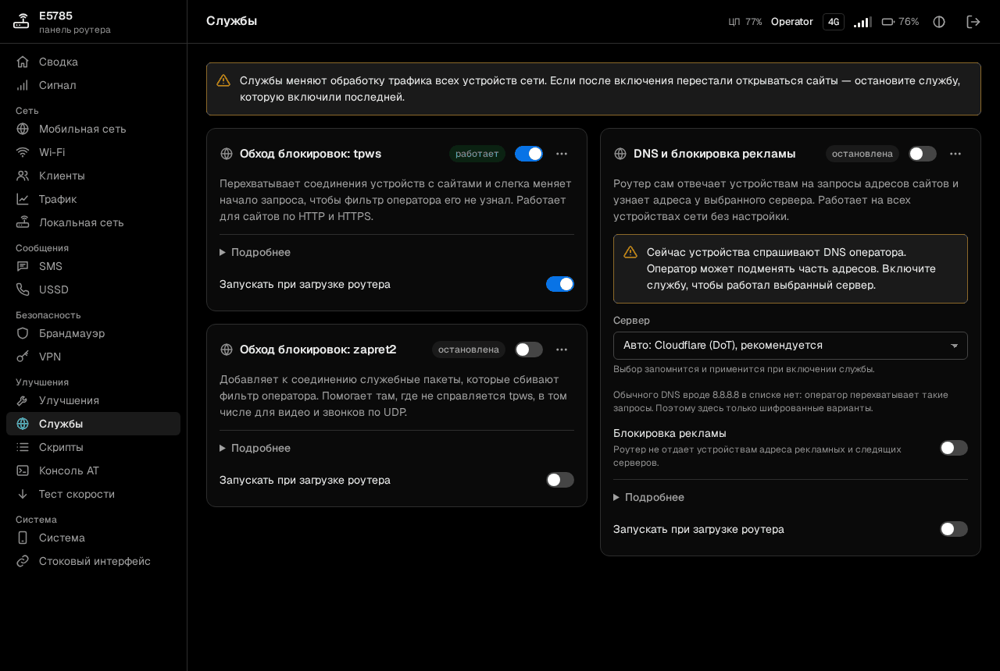

## Если роутер испорчен

Для роутера после чужой прошивки. Порядок проверен на настоящем роутере, испорченном прошивкой от 22c.

| неисправность | что есть | статус | подробно |
|---|---|---|---|
| не загружается, режим прошивки | fastboot в памяти, образы YAFFS2, сверка байт в байт | на роутере; `flash_fw.sh` на заглушке | [восстановление](recovery.md) |
| стоковая прошивка, нужен мод | тот же порядок | не проверено | [со стоковой прошивки](recovery.md#со-стоковой-прошивки) |
| нет сети после прошивки от 22c | правка NV из официального пакета, секция `product_id=33` | на роутере значениями из его копии; значения из XML не записывались | [исправление NV](nv-fix.md) |
| сам выключается, «перегрев» | причина и обновление `nvsys` | на роутере | [ложные выключения](thermal.md) |

## Чего нет

| что | почему |
|---|---|
| лимит заряда | не делается; встроенная защита есть по именам функций в ядре, не измерена |
| смена IMEI | комплект не касается |
| 5 ГГц и гостевая сеть | выключены в действующих настройках прошивки: `wifi5g_enabled=0`, `guestwifi_enable=0` |
| IPv6, SD-карта, проводной порт, VoLTE | на 23c нет |
