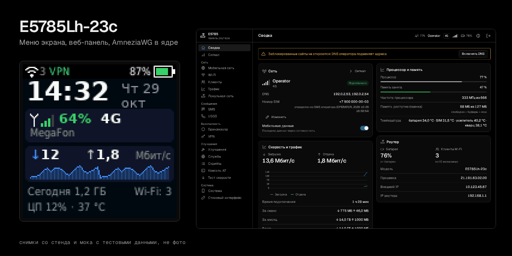
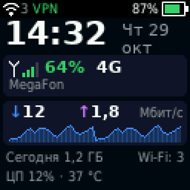
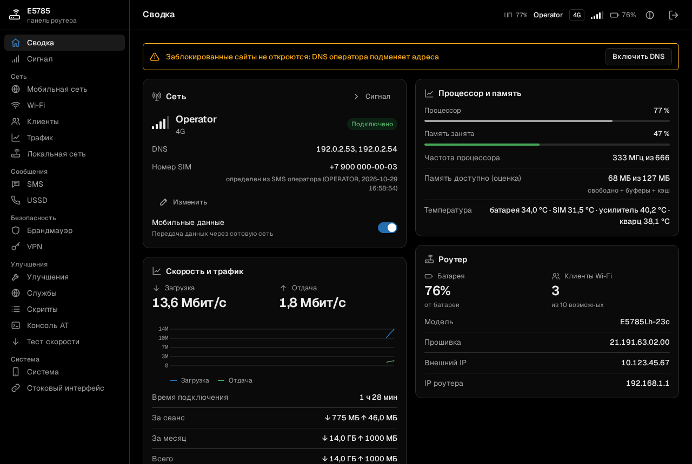

# Установка E5785Lh-23c

Для того, кто уже решил ставить. Только для E5785Lh-23c, на 22c ставить нельзя. Все возможности с картинками: [features.md](features.md). Подробности шагов — по ссылкам ниже.



## Не проверено

Весь порядок выполнен на одном роутере. Пункты меню, главный экран, логотип, анимация, страницы панели и сохранение настроек проверены пользователем на этом роутере. Обычной работой не проверяется:

- Установка на чистый роутер и установка мода со стоковой прошивки.
- Настоящая установка скриптом `install-all.sh`, ветка `--reboot`, запись логотипа этим скриптом: на роутере прошел только `--dry-run`.
- Настоящая установка из `prebuilt/` на роутер и сверка sha256 с программами на роутере.
- `get-bins.sh --fetch`, `--via=jump`, синтаксис Lua через `luac`.
- Загрузка готовым `balong-usbdload`, `flash_fw.sh`, значения NV из XML.
- Смена профиля с настоящими порогами, выход в интернет через запасной `amneziawg-go`, приложения банков на телефоне.
- Долгая работа.

## Что ставится

- Меню экрана: свой главный экран, меню на русском, игра «Орбита».
- Логотип и анимация загрузки.
- Веб-панель: все настройки роутера, тест скорости.
- VPN: AmneziaWG, модуль ядра, раздельный режим, смена профиля при обрыве.
- DNS: шифрованные серверы, запасные серверы, блокировка рекламы; обход блокировок.

## Какой у вас случай

| случай | что делать |
|---|---|
| мод bay v5 уже стоит | сразу [одна команда](#одна-команда) |
| стоковая прошивка | [со стоковой прошивки](recovery.md#со-стоковой-прошивки), затем одна команда |
| роутер не загружается | [восстановление](recovery.md), затем одна команда |
| ставилась прошивка от 22c | [восстановление](recovery.md), [исправление NV](nv-fix.md), затем одна команда |

## Что нужно

- Компьютер с Linux, `ssh`, `tar`, `curl`, `ip`, `python3`, для логотипа Pillow.
- Роутер по USB, мод bay v5 на прошивке 21.191.63.02, `modwebui_1.5a`.
- Вход по SSH с ключом ECDSA: [пункт «Ключ SSH»](oled-menu.md#вход-по-ssh), подробности — [установщик](install-all.md#что-нужно).
- Для восстановления: иголка, `fastboot`, `pyusb`, файлы по [списку](recovery.md#что-понадобится).

## Одна команда

На компьютере, из корня комплекта:

```bash
webui/src/pkg/get-bins.sh        # пакеты из prebuilt/, сеть не нужна; для модуля ядра добавьте --module
./install-all.sh --dry-run       # проверки и план, флеш не меняется
./install-all.sh                 # панель и меню
./install-all.sh --logo          # логотип, спросит подтверждение
```

Скрипт проверяет модель и мод, останавливается при первой ошибке и печатает команды отката. Меню заработает после перезагрузки: ключ `--reboot` или вручную. Все ключи: [установщик](install-all.md).

## Вручную

1. Настройте [вход по SSH](oled-menu.md#вход-по-ssh).
2. Поставьте [веб-панель](../webui/README.md).
3. Поставьте [меню экрана](oled-menu.md#установка).
4. По желанию замените [логотип](boot-logo.md#логотип). Анимация ставится вместе с меню.

## Проверка

После установки панели и после первой перезагрузки, на компьютере:

```bash
curl -s -o /dev/null -w '%{http_code}\n' http://192.168.1.1/
ssh root@192.168.1.1 'busyboxx sh /online/mod/mod-ctl.sh status; busyboxx sh /online/mod/pkg/awg/svc.sh brief'
```

| что смотреть | ожидается |
|---|---|
| `curl` | `200` |
| `mod-ctl.sh status`, строка помощника | «работает», «очередь отвечает» |
| `svc.sh brief`, если VPN включен | `running=1`, `engine=kernel` или `engine=go` |
| экран роутера | анимация при загрузке, затем главный экран |



В браузере: `http://192.168.1.1/`, вход с паролем веб-интерфейса роутера.



Снимки сделаны на стенде и моке с тестовыми данными, это не фото. Результат сообщите в теме 907081 на 4PDA.

Риск: `/online` принадлежит uid 1000, поэтому процесс с этим uid может подменить `/online/mod` и получить root.

## Откат

| часть | команда |
|---|---|
| панель | `webui/src/installer/rollback.sh`, только последняя установка: `--last` |
| меню | `ssh root@192.168.1.1 'busyboxx sh /online/hij_install/rollback.sh'` и перезагрузка |
| логотип | команды печатает `install-all.sh`, копия раздела в `logo-backup-ДАТА.bin` |
| модуль ядра | только перезагрузка: [выгружать нельзя](../kernel-module/README.md) |

## Частые проблемы

| признак | куда смотреть |
|---|---|
| белый или черный экран, режим прошивки | [восстановление](recovery.md) |
| нет сети, RSRP около −122 дБм, пустое имя модели | [исправление NV](nv-fix.md) |
| роутер сам выключается | [ложные выключения](thermal.md) |
| заблокированные сайты не открываются | первые полминуты это норма; [VPN](vpn.md#dns-вместе-с-vpn) |
| нет пункта меню | [меню экрана](oled-menu.md#пункты-меню) |
| все остальное | [частые проблемы](troubleshooting.md) |
