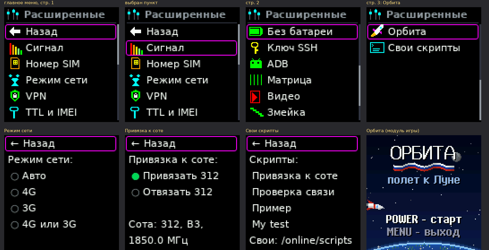
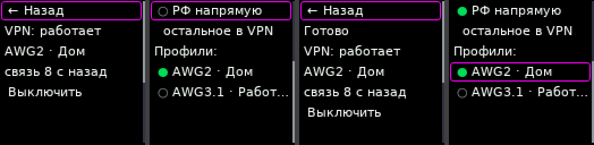
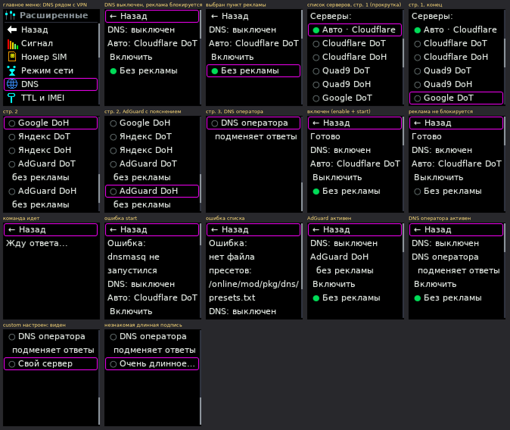
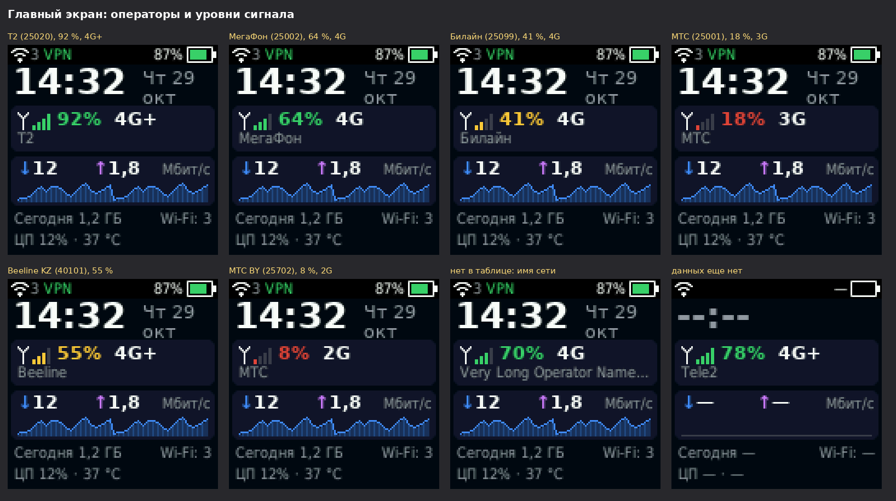
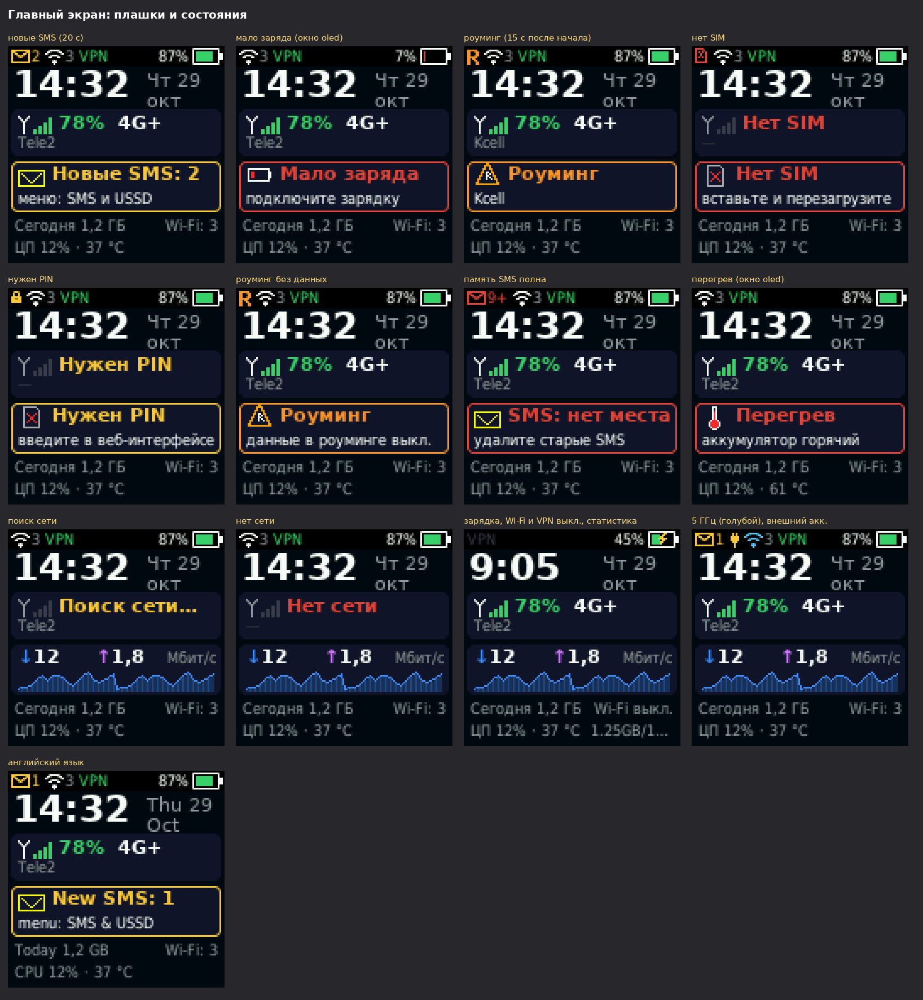

# Меню экрана

Для владельца E5785Lh-23c с модом bay v5: что умеет меню на экране роутера, как его поставить и откатить. На форуме его зовут секретным меню. Основа — [huawei_oled_hijack_ng](https://github.com/alexbers/huawei_oled_hijack_ng), свой код и значки описаны в [CREDITS.md](../CREDITS.md).

Нужны: прошивка 21.191.63.02 с модом bay v5 и `modwebui_1.5a` ([восстановление](recovery.md)), вход по SSH.



## Кнопки

| где | кнопка | что происходит |
|---|---|---|
| экран погашен | POWER | экран загорается, больше ничего |
| главный экран | короткое POWER | открывается меню |
| где угодно | долгое МЕНЮ | открывается меню |
| родное меню | POWER на пункте «Расширенные» | открывается меню |
| окно родной программы | кнопки | работают как в родной программе |
| где угодно | долгое POWER | родное выключение |
| меню | МЕНЮ | следующий пункт |
| меню | POWER | выбрать пункт |
| пункт «Орбита» | POWER, МЕНЮ | тяга; пауза и выход |

## Пункты меню

Пункт появляется, только если есть все нужные ему файлы. Проверка идет при каждом входе в меню.

| пункт | что делает | что нужно |
|---|---|---|
| Сигнал | RSRP, RSRQ, SINR, RSSI, полоса, диапазон, график | — |
| Номер SIM | номер из настроек SIM или кэша веб-панели, USSD не шлет | — |
| Режим сети | авто, 4G, 3G, 4G или 3G | — |
| SMS и USSD | чтение, удаление, запрос USSD | компонент SMS: `SMS=1` при установке |
| Wi-Fi | включить и выключить, клиенты, запрет по MAC | — |
| VPN | состояние, включить и выключить, выбор профиля, [«РФ напрямую»](#рф-напрямую) ([VPN](vpn.md)) | [веб-панель](../webui/README.md), пакет `awg` |
| DNS | включить и выключить, выбор сервера, блокировка рекламы ([подробнее](#пункт-dns)) | [веб-панель](../webui/README.md), пакет `dns` |
| Тест скорости | прием и передача, график | [веб-панель](../webui/README.md): список серверов и `curl` |
| TTL и IMEI | из мода, скрипт `ttl_and_imei.sh` комплект не меняет | — |
| Без батареи | работа от USB без аккумулятора, пишет NV 50364 | — |
| Ключ SSH | вход по своему ключу | — |
| ADB | запуск `adbd` мода | — |
| Матрица, Змейка | заставка и игра из исходного меню | — |
| Видео | поток с сервера автора исходного меню, около 1 МБ/с | сеть |
| Орбита | [игра](../game/README.md) | — |
| Свои скрипты | «Привязка к соте», «Проверка связи», скрипты из `/online/scripts` | — |

«Привязка к соте» пишет NV 53810 и сразу обновляет `nvsys`. Пункт «Перезагрузите роутер» появляется, только когда запись закончена. «Проверка связи» раз в 20 с шлет 10 пингов на `8.8.8.8` и при потере перезапускает радио.

## РФ напрямую

Переключатель на странице профилей пункта «VPN». Включает раздельный VPN: российские адреса идут напрямую, остальное через туннель. Подробно: [VPN](vpn.md#раздельный-vpn).



| что на экране | что значит |
|---|---|
| зеленый кружок | раздельный режим включен |
| пустой кружок | выключен |
| «Нет списка: см. панель» | список адресов не загружен, состояние не изменилось |
| «Не действует: VPN не на весь трафик» | в профиле `AllowedIPs` не на весь трафик |
| «Готово» | команда прошла |
| «Ошибка:» и строка ответа | `svc.sh split` отказал |

Снимки сделаны на стенде: настоящие `oled_widgets.c` и `vpn_menu.sh`, заглушка `svc.sh`.

## Пункт DNS

Управляет пакетом `dns` веб-панели. Пункт виден, если есть `/online/mod/pkg/dns/svc.sh` и `/app/hijacks/scripts/dns_menu.sh`.



| экран | что есть |
|---|---|
| первый | «DNS: включен» или «DNS: выключен», текущий сервер, «Выключить» или «Включить», «Без рекламы» с отметкой |
| «Серверы:» | список серверов пакета, у текущего отметка; выбор запоминается, у работающей службы применяется сразу |
| ошибка | «Ошибка:» и первая строка ответа `svc.sh`, ниже прежний экран |

«Включить» выполняет `svc.sh enable` и `start`, «Выключить» — `stop` и `disable`, поэтому выбор переживает перезагрузку. Если `start` не прошел, флаг автозапуска снимается. Пара команд идет в отдельном процессе и доходит до конца, даже если меню закрыли.

Пока команда идет, на экране «Жду ответа...».

## Главный экран



| строка | что показывает |
|---|---|
| значки | сигнал Wi-Fi и клиенты, VPN, SMS, заряд |
| часы и дата | локальное время роутера, пояс приходит от сети |
| сигнал | вышка, проценты, тип сети, имя оператора |
| скорость | прием, передача, график за 80 с: 40 точек раз в 2 с |
| низ | трафик за сегодня, клиенты Wi-Fi, ЦП, температура батареи |

Проценты сигнала считает формула. Цвет: от 60 % зеленый, 30–59 % желтый, ниже — красный.

| сеть | составляющие | итог |
|---|---|---|
| LTE | `a = (RSRP + 120) * 100 / 45`, `b = (SINR + 5) * 100 / 30`, каждое 0–100 | `(3a + 2b) / 5`, не выше `min(a, b) + 30` |
| 3G | RSCP от −115 до −75 дБм, Ec/Io от −20 до −3 дБ | так же |
| 2G | RSSI от −110 до −60 дБм | значение шкалы |
| нет измерений | полоски родной программы | полоски × 20 |

Имя оператора берется по MCC-MNC из таблицы, иначе — имя, которое передает сеть. Таблицы:

| файл | что это |
|---|---|
| `/online/mod/conf/operators.txt` | ваша таблица, читается первой |
| `/app/hijacks/conf/operators.txt` | таблица набора: Россия, Казахстан, Беларусь, Украина, Узбекистан, Кыргызстан, Армения, Грузия, Азербайджан |

Формат строки: `25020 T2`.

Выключить свой экран без отката: создайте файл `/online/mod/conf/oled_home_off` и перезагрузите роутер.

Свой экран включается, только если контрольная сумма кода программы экрана совпала с известной сборкой 21.191.63.02. На другой сборке экран остается родным.

Заряд, перегрев, SIM, роуминг и SMS показываются плашками на своем экране. Остальные родные окна идут родным кадром поверх всего: пока окно открыто, своего экрана нет.



## Вход по SSH

1. Создайте ключ ECDSA на компьютере: dropbear мода не знает ed25519.

   ```bash
   ssh-keygen -t ecdsa -b 256 -f ~/.ssh/e5785
   ```

2. Откройте пункт «Ключ SSH». На экране появится имя вида `pin123456`.
3. Подключитесь под этим именем, пока экран открыт:

   ```bash
   ssh -i ~/.ssh/e5785 pin123456@192.168.1.1
   ```

4. Ключ запомнен. Дальше вход: `ssh -i ~/.ssh/e5785 root@192.168.1.1`. Адрес тот же по Wi-Fi и по USB.

## Установка

Одной командой: [`install-all.sh --menu`](install-all.md). Ниже то же вручную. Все команды — на компьютере, из корня комплекта.

1. Скопируйте набор на роутер:

   ```bash
   tar -C oled-menu/install -cf - . | ssh root@192.168.1.1 'busyboxx mkdir -p /online/hij_install && cd /online/hij_install && busyboxx tar -xf -'
   ```

2. Подготовьте подписи родного меню из файлов вашего веб-интерфейса. Скрипт сверит результат с `MANIFEST`:

   ```bash
   ssh root@192.168.1.1 'busyboxx sh /online/hij_install/mk_oled_cfg.sh'
   ```

3. Проверьте, что установка пройдет. Ничего не меняется:

   ```bash
   ssh root@192.168.1.1 'cd /online/hij_install && DRY=1 busyboxx sh install.sh'
   ```

4. Поставьте набор, резервная копия ляжет в `/online/hijacks_backup_<дата>`:

   ```bash
   ssh root@192.168.1.1 'cd /online/hij_install && busyboxx sh install.sh'
   ```

5. Если нужны SMS и USSD, поставьте и их (отдельная копия, отдельный откат):

   ```bash
   ssh root@192.168.1.1 'cd /online/hij_install && SMS=1 busyboxx sh install.sh'
   ```

6. Перезагрузите роутер:

   ```bash
   ssh root@192.168.1.1 'busyboxx setsid busyboxx sh -c "sleep 2; sync; busyboxx reboot -f" &'
   ```

7. Проверьте: при загрузке идет анимация, в родном меню есть «Расширенные», меню открывается. Для компонента SMS после перезагрузки: `busyboxx sh /online/hij_install/check_sms.sh`. Строка про `sms-count` требует `curl` из веб-панели.

Что еще умеет `install.sh`:

| переменная | что делает |
|---|---|
| `DRY=1` | только проверки |
| `SMS=1` | ставит и SMS, USSD: перехват в программе `sms` |
| `DEBUG=0` | без журнала `/var/hijack_bootanim.log` |
| `FORCE=1` | ставит, даже если текущие файлы не известны набору |

`install.sh` знает версии файлов мода bay v5. Файлы, у которых другой md5, он не заменит без `FORCE=1`. Старые файлы он не перезаписывает на месте, потому что это уронит работающую программу экрана: новый файл кладется рядом и переименовывается.

## Откат

На роутере, без аргумента — самая новая копия:

```bash
busyboxx sh /online/hij_install/rollback.sh
busyboxx sh /online/hij_install/rollback.sh /online/hijacks_backup_<дата>
```

Затем перезагрузите роутер. Если ставили и SMS, откатите сначала SMS (самая новая копия), затем основной набор.

## Файлы набора

| путь в `/app` | что это |
|---|---|
| `hijacks/lib/oled_hijack.so` | меню, главный экран, анимация, игра |
| `hijacks/oled_cfg/menue.xml`, `res/lang_*.xml` | подпись и значок пункта 13; готовит `mk_oled_cfg.sh` |
| `hijacks/bootanim/` | кадры и длительности |
| `hijacks/bin/hijlua`, `luarun` | Lua 5.1 роутера для скриптов Wi-Fi, SMS и USSD |
| `hijacks/scripts/` | скрипты пунктов меню |
| `hijacks/conf/nv50018_req.bin` | запрос сброса `nvsys` для «Привязки к соте» |
| `hijacks/conf/operators.txt` | имена операторов |
| `hijacks/lib/sms_webhook.so`, `bin/sms_webhook_client`, `bin/sms` | компонент SMS |

Полный список с контрольными суммами — [`oled-menu/install/MANIFEST`](../oled-menu/install/MANIFEST). Подмена `menue.xml` и подписи идет через перехват `cl_xmlParseFile`: файлы веб-интерфейса на роутере не меняются.

## Сборка из исходников

Нужны clang и lld (проверено на clang 19), `git`, копии библиотек роутера. NDK не нужен.

```bash
git clone -b android10-release https://github.com/aosp-mirror/platform_bionic.git
ssh root@192.168.1.1 'cd /system/lib && busyboxx tar -cf - libc.so libdl.so libm.so' | (mkdir -p syslib && tar -C syslib -xf -)
ssh root@192.168.1.1 'cd /app/lib && busyboxx tar -cf - liblua.so libmsgapi.so librestcore.so' | (mkdir -p applib && tar -C applib -xf -)
sh oled-menu/build/prepare_sysroot.sh platform_bionic syslib applib
sh oled-menu/build/build_r10.sh out
sh oled-menu/build/build_hijlua.sh out
```

Сборка воспроизводима: файлы из `out` совпадают по md5 с файлами набора. Сверьте `oled_hijack.so`, `sms_webhook.so`, `sms_webhook_client`, `hijlua` с `MANIFEST`. Флаги `-DNATIVE_MENU_ITEM=13` и `-DOLED_CFG_OVERRIDE_DIR` обязательны: без них молча пропадает вход через родное меню, поэтому собирайте через `build_r10.sh`.

| файл | что это |
|---|---|
| `oled-menu/src/` | полное дерево: исходный проект и свои файлы |
| `oled-menu/patches/r10_vs_upstream_0807e72.patch` | то же в виде патча к коммиту `0807e72`, `patch -p1` |
| `oled-menu/tools/` | генераторы сглаженного шрифта, значков, углов рамки |
| `oled-menu/test/run_pc.sh` | проверки на компьютере с ASan и UBSan, без роутера |
| `oled-menu/test/dns/run.sh` | стенд пункта DNS: настоящие меню, `dns_menu.sh` и `svc.sh` в песочнице `bwrap`, службы и `iptables` — заглушки |

## Ограничения

- Все пункты меню, главный экран и анимация проверены пользователем на одном роутере, долгая работа не проверена.
- Только для 23c: адреса в коде программы экрана заданы для `oled.orig` 21.191.63.02, контрольная сумма кода проверяется при старте.
- Пункт меню «Видео» обращается к серверу автора исходного меню.
- После установки перемонтирование `/app` может ответить `Device or resource busy`: старый `.so` держит запущенная программа. Раздел останется доступным на запись до перезагрузки. Перезагрузка это исправляет.
- `mk_oled_cfg.sh` на роутере выполнен только в проверочном прогоне, во временном каталоге: md5 совпали с `MANIFEST`. При ошибке он сообщит md5, и `install.sh` такой набор не примет.
