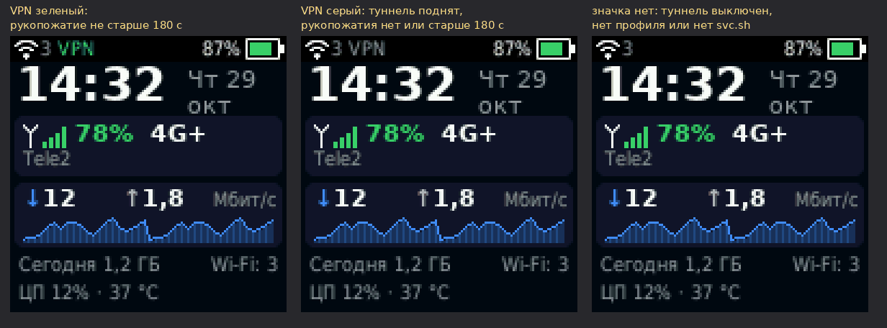

# VPN

Для того, кто пользуется AmneziaWG на роутере. В комплекте VPN — это пункт меню экрана и значок на главном экране. Сами туннели и профили настраивает [веб-панель](../webui/README.md): ставит пакет `awg`, принимает конфигурации.

## Меню экрана

Пункт «VPN» виден, если есть `/online/mod/pkg/awg/svc.sh` и `/app/hijacks/scripts/vpn_menu.sh`.

| экран | что есть |
|---|---|
| первый | «VPN: работает» или «VPN: не работает», подпись профиля, «связь N с назад», «Выключить» или «Включить» |
| «Профили:» | список профилей, у текущего отметка; выбор переключает профиль |

Пока команда идет, на экране «Жду ответа...» и кнопка POWER не принимается. Ошибка `svc.sh` показывается строкой «Ошибка:».

Меню обращается к пакету только этими командами. Конфигурации оно не разбирает.

| команда | ответ |
|---|---|
| `svc.sh list` | строки `id\|подпись\|протокол\|активный` |
| `svc.sh brief` | `running=0/1\|profile=...\|label=...\|handshake=секунд назад\|engine=kernel или go` |
| `svc.sh split on`, `split off`, `split-status` | раздельный VPN, `split_list=0/1` — загружен ли список |
| `svc.sh use ID`, `start`, `stop` | код 0 — успех, 1 — ошибка, текст в stderr |

## Значок на главном экране

| значок | условие |
|---|---|
| нет | `running=0`, нет профиля или нет `svc.sh` |
| серый | `running=1`, рукопожатия нет или оно старше 180 с |
| зеленый | `running=1` и рукопожатие не старше 180 с |

Порог 180 с — предел WireGuard (`REJECT_AFTER_TIME`). Значок обновляется раз в 15 с. Простаивающий туннель без `PersistentKeepalive` через 180 с может стать серым: это догадка по протоколу, отдельно не проверялось.

## WireGuard мода

Если есть `/online/vpn.conf`, в «Свои скрипты» появится «VPN мода»: скрипт `vpn.sh` из мода bay v5. Он работает отдельно от `awg`.

## Движок и автозапуск

| что | как работает | что проверено |
|---|---|---|
| модуль ядра, вариант NEON | основной при `ENGINE=auto`, ставится `get-bins.sh --module` | прогон 164 МБ, ошибок ядра 0 |
| настройка «Включать при загрузке роутера» | по умолчанию выключена | перезагрузкой: туннель поднялся сам к 26 с, на модуле; панель отвечает http 200, помощник работает |
| запасной переход на `amneziawg-go` | при `ENGINE=auto`, если модуль не сработал; `engine_fallback=1` | переход и связь с сервером есть, выход в интернет через туннель на этом пути не подтвержден |

## Раздельный VPN

Российские адреса идут напрямую, остальное через туннель. Включен по умолчанию, в меню экрана это [«РФ напрямую»](oled-menu.md#рф-напрямую).

| что | как работает | что проверено |
|---|---|---|
| без списка адресов | обычный полный VPN | комплект списка не содержит: это данные RIPE NCC |
| список | получаете сами: `webui/src/pkg/awg/tools/split-gen.py` из файла статистики RIPE NCC; условия RIPE читайте сами, это не юридическое заключение | проверено пользователем на одном роутере, на клиенте-контейнере; приложения банков на телефоне не проверены |

Подробно: [`webui/src/pkg/awg/README.md`](../webui/src/pkg/awg/README.md).

## Смена профиля при обрыве

Включена по умолчанию, при одном профиле ничего не делает. Пороги: нет рукопожатия 180 с, пауза между переходами 300 с, проба основного профиля раз в 1800 с. На роутере проверена с сокращенными порогами, настоящие значения только включены.

## DNS вместе с VPN

DNS включается вместе с VPN, если вы не выключили его вручную. При отказе DoT служба переходит на запасные серверы и возвращается, когда DoT заработает.

После загрузки настоящие адреса приходят примерно через полминуты. На роутере `/dev/random` заменяется на `/dev/urandom`, если есть запас случайных чисел из файла. Первая загрузка без файла запаса дает около 3 минут. Это проверено перезагрузкой.

## Что ожидать по скорости

| где | Мбит/с |
|---|---|
| напрямую | до 105 |
| через VPN | 21–46, зависит от сервера и числа потоков; упор в процессор |
| через VPN, один поток | 7–22 |

Больше этого не ждите: роутер упирается в процессор. Настройки `GO_GC`, `GOMAXPROCS` и `MTU` заметно не помогают.

Установка, профили, DNS и работа пакетов — в [`webui/README.md`](../webui/README.md). Модуль ядра вместо `amneziawg-go` — экспериментальный, работает на одном роутере, пакет `awg` выбирает его настройкой `ENGINE`. ЦП на мегабит чаще ниже. Выгружать его нельзя, это паника ядра: [`kernel-module/`](../kernel-module/README.md).
