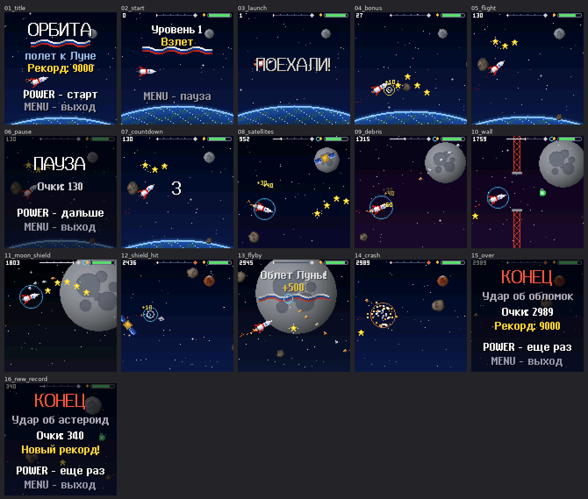

# Орбита

Игра для меню экрана: ракета летит к Луне. Одна кнопка: POWER — импульс тяги, гравитация тянет вниз. МЕНЮ — пауза; на паузе, заставке и экране «Конец» — выход. Лицензия LGPL-3.0.

Игра входит в набор меню: `oled_orbit.c` и `oled_orbit.h` — те же файлы, что в `oled-menu/src/`. Рекорд хранится в `/online/mod/conf/orbit_best`.

| файл | что это |
|---|---|
| `oled_orbit.c`, `oled_orbit.h` | модуль игры: 5 функций, один таймер 50 мс (20 кадров в секунду), без `malloc` и плавающей точки |
| `test/run.sh` | все проверки на компьютере и картинки в `preview/` |
| `test/orbit_sim.c` | обвязка: заглушки экрана и таймеров, автопилот, стресс |
| `test/arm_check.sh` | сборка под роутер на копии исходников меню |
| `preview/` | кадры и `orbit_autopilot.gif` |

Что проверяет `test/run.sh`: крайние случаи и 200 000 кадров с ASan, UBSan и LSan; потоки таймера и кнопок с TSan; партии автопилота. Запуск без роутера, нужен clang и python3 с Pillow.

Игра проверена пользователем на одном роутере. Ограничение: загрузка ЦП на роутере не измерялась. На компьютере тик занимает 8 мкс в среднем, на роутере будет больше.
